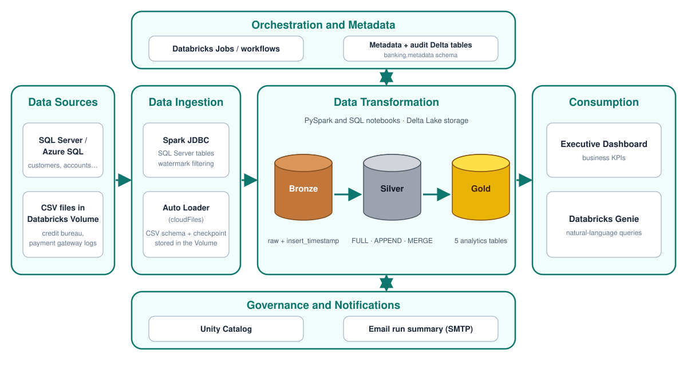
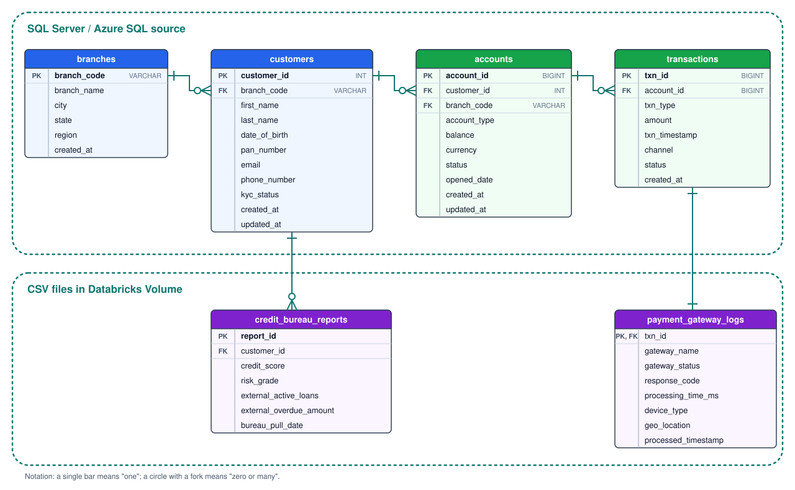
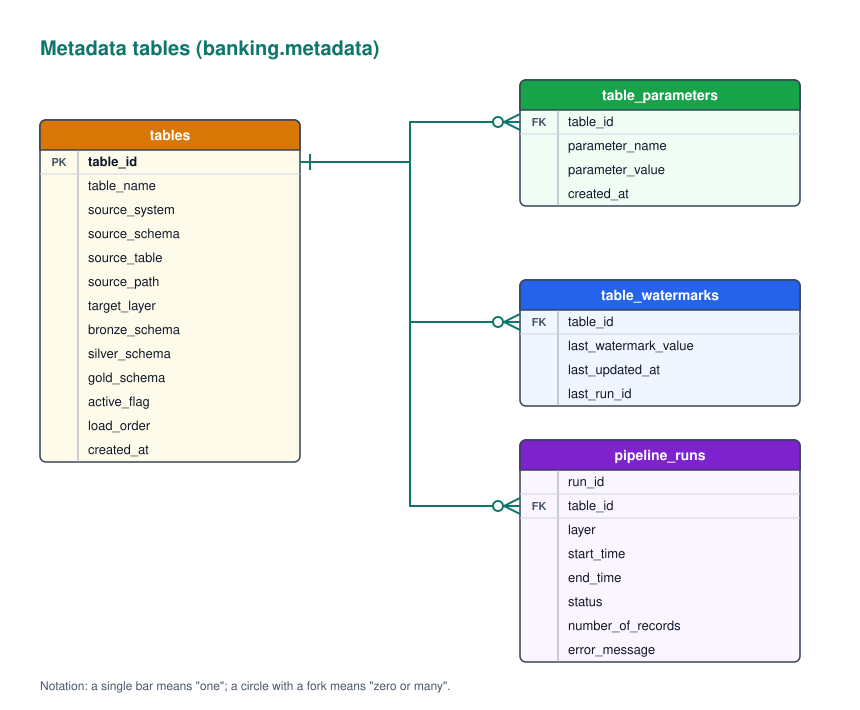
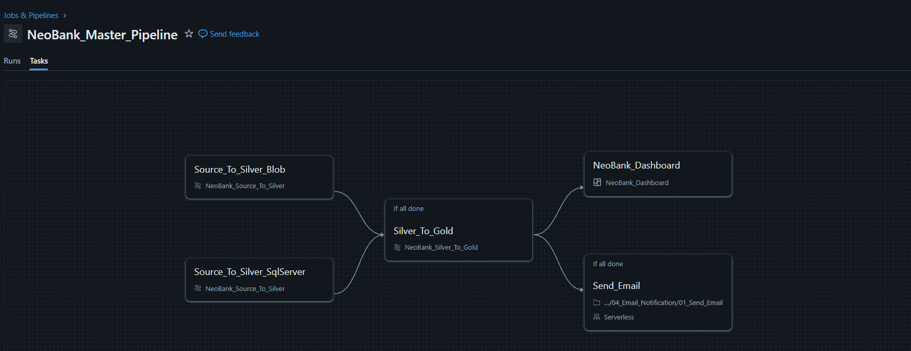
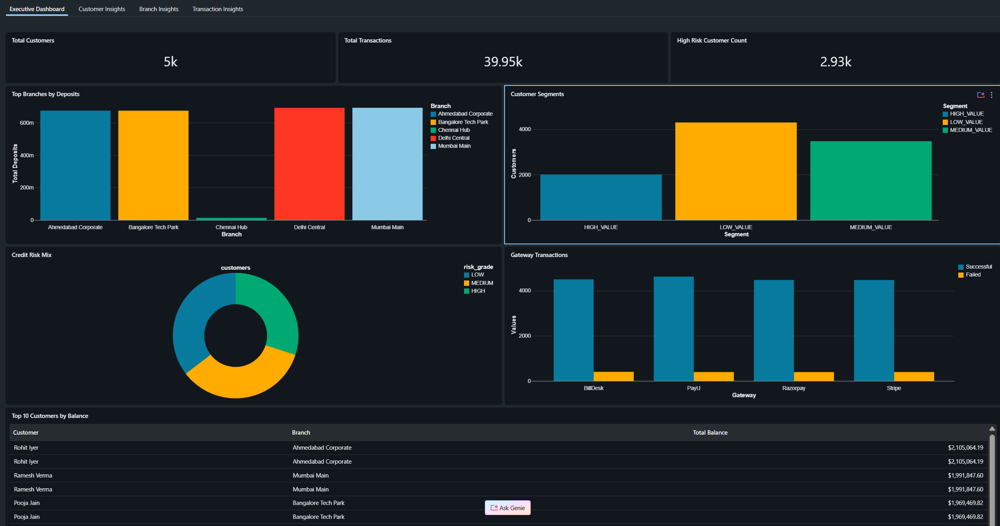

# NeoBank — Metadata-Driven Data Engineering on Databricks

A portfolio project demonstrating a configurable banking data pipeline built with **Databricks, PySpark, Delta Lake, and SQL**. The pipeline ingests data from SQL Server and CSV files, processes it through the **Bronze → Silver → Gold** Medallion Architecture, records execution metadata, and publishes analytics-ready Gold tables for dashboards and Databricks Genie.

## Project Overview

NeoBank simulates a banking analytics environment where operational data is spread across relational tables and external-style files. The project brings these datasets into a unified Lakehouse workflow and uses metadata to control which tables are processed, how they are loaded, and how runs are audited.

The implementation includes:
- Metadata tables for source registration, load parameters, watermarks, and pipeline audit records.
- SQL Server ingestion through Spark JDBC.
- CSV ingestion with Databricks Auto Loader (`cloudFiles`) from a Databricks Volume.
- Bronze-to-Silver processing with `FULL`, `APPEND`, and `MERGE` load strategies.
- Gold-layer SQL transformations for customer, branch, transaction, banking KPI, and credit-risk analytics.
- Run-status email summaries.
- An executive dashboard and Databricks Genie interface for data consumption.

> **Storage note:** The file-based source path uses CSV files manually uploaded to a Databricks Volume to simulate externally stored files. This repository does not represent a live cloud Blob Storage connection.

## Architecture

The following diagram shows the end-to-end NeoBank pipeline, including source ingestion, the Medallion layers, metadata/auditing, governance, and consumption.



## Data Sources

The project models the following banking datasets:

| Dataset | Source / purpose |
|---|---|
| `customers` | Customer details and branch association; configured for `MERGE` using `customer_id` and `updated_at`. |
| `accounts` | Customer accounts and balances; configured for `MERGE` using `account_id` and `updated_at`. |
| `transactions` | Transaction records; configured for `APPEND` using `txn_id` and `txn_timestamp`. |
| `branches` | Branch reference data; configured for `FULL` loading using `branch_code`. |
| `credit_bureau_reports` | Credit scores, risk grades, external loans, and overdue amounts; CSV file source configured for `MERGE`. |
| `payment_gateway_logs` | Payment gateway and processing information; CSV file source configured for `APPEND`. |

The relational source is read using Spark JDBC with connection details retrieved from Databricks Secrets. File-based CSV ingestion uses Auto Loader against a configured Databricks Volume path.

### Source Data Model

The source ER diagram shows the relationships between the core banking tables and the supporting credit bureau and payment gateway datasets.




## Medallion Architecture

### Bronze — Source ingestion

The `04_Source_To_Bronze` notebook reads source metadata and parameters, then selects the ingestion method based on `source_system`.

- **SQL Server:** reads source tables using Spark JDBC and writes to Delta Bronze tables in append mode.
- **File source:** uses Auto Loader (`cloudFiles`) to read CSV files from the configured volume path, with schema and checkpoint locations under the volume.
- Adds an `insert_timestamp` column.
- Uses the configured watermark to filter eligible SQL Server records for applicable `APPEND` and `MERGE` loads.
- Records ingestion failures in the pipeline audit table.

### Silver — Standardization and load strategies

The `05_Bronze_To_Silver` notebook reads Bronze data and applies the configured load strategy.

| Load type | Behavior in Silver |
|---|---|
| `FULL` | Overwrites the Silver table. |
| `APPEND` | Appends records to the Silver table. |
| `MERGE` | Uses Delta Lake `MERGE` on the configured primary key to update matched records and insert new records. |

The notebook adds `insert_timestamp` and `update_timestamp` audit columns, tracks records read, records execution status, and updates the configured watermark for `APPEND` and `MERGE` processing.

### Gold — Business-ready analytics

The Gold layer uses SQL transformations over Silver tables to create analytics-ready outputs.

| Gold table | Purpose |
|---|---|
| `customer_360` | Combines customer, branch, account, transaction, and latest available credit bureau information. Derives a customer segment from total account balance. |
| `branch_performance` | Summarizes customers, accounts, balances, transaction counts, and transaction amounts by branch. |
| `transaction_channel_summary` | Aggregates transaction counts, successful and failed gateway outcomes, and average processing time by date, gateway, and device type. |
| `daily_bank_kpi` | Combines daily transaction metrics with customer, account, balance, average credit score, and high-risk customer metrics. |
| `risk_customer_summary` | Aggregates customer counts, average credit score, active external loans, and overdue amounts by risk grade. |

Each Gold transformation notebook returns the resulting row count to its calling workflow.

## Metadata-Driven Design

Pipeline behavior is controlled by tables in the `banking.metadata` schema.

| Metadata table | Purpose |
|---|---|
| `tables` | Registry of tables, source system, source schema/table or path, target layer and schemas, active flag, load order, and creation time. |
| `table_parameters` | Per-table configuration such as `load_type`, `primary_key`, and `watermark_column`. |
| `table_watermarks` | Stores the last processed watermark and related update/run metadata. |
| `pipeline_runs` | Captures run ID, table ID, layer, start/end times, status, record count, and error message. |

### Metadata Schema

The metadata ER diagram shows how the central `tables` registry relates to its parameters, watermark state, and pipeline-run audit records.




### Metadata-driven execution flow

1. Register a source or target table in `banking.metadata.tables`.
2. Store its load strategy and applicable key/watermark settings in `banking.metadata.table_parameters`.
3. Read active table definitions and order them by `load_order`.
4. Pass table metadata and parameters to processing notebooks through Databricks widgets and task values.
5. Run ingestion and transformation workflows using the supplied configuration.
6. Record processing status and update watermark metadata where applicable.
7. Use audit records to build a run summary and send an email notification.

This separates table-specific configuration from reusable processing logic, reducing the need to hardcode a separate ingestion implementation for every source.

## Orchestration, Auditing, and Notifications

### Databricks Jobs

The `NeoBank_Master_Pipeline` is the master Databricks job that orchestrates the end-to-end data pipeline. It ingests data from two sources—cloud files (Blob-style ingestion) and SQL Server—and coordinates downstream transformations and notifications through task dependencies.

The master job consists of the following tasks:

1. **`Source_To_Silver_Blob`** — Executes the source-to-silver workflow for CSV files uploaded to the Databricks Volume, simulating cloud file ingestion.
2. **`Source_To_Silver_SqlServer`** — Executes the source-to-silver workflow for data ingested from SQL Server.
3. **`Silver_To_Gold`** — Runs after both source-ingestion tasks complete successfully, transforming the Silver-layer data into Gold-layer analytical tables.
4. **`NeoBank_Dashboard`** — A downstream dashboard task configured to run after the Silver-to-Gold task completes.
5. **`Send_Email`** — Sends an email notification after the Silver-to-Gold task completes.

The two source-ingestion tasks run as separate branches and converge at `Silver_To_Gold`. The dashboard and email notification tasks are configured as downstream tasks using an **“If all done”** dependency, meaning they can run after the upstream task finishes regardless of whether it succeeded or failed. Their own execution outcomes should therefore be checked separately.

This orchestration separates source ingestion from analytical transformations and provides a centralized workflow for running the NeoBank pipeline.



### Pipeline Audit

The `pipeline_runs` metadata table maintains an audit trail of pipeline execution, including:

- Run and table identifiers.
- Processing layer.
- Start and end timestamps.
- Execution status (`INPROGRESS`, `SUCCESS`, or `FAILED`).
- Record count and error details.

This audit information supports execution monitoring and troubleshooting across the pipeline.


### Email notification

The email notebook reads audit details for a supplied run ID, determines an overall status, formats the audit rows as an HTML table, and sends a summary using SMTP. Sender, receiver, and SMTP credentials are read from Databricks Secrets rather than being embedded directly in the notebook.

## Governance and Consumption

- **Unity Catalog:** used as the project's data governance and organization layer.
- **Executive dashboard:** presents business-facing views built from curated data.
- **Databricks Genie:** provides a natural-language interface for exploring the configured analytics data.

Dashboard screenshots and a short walkthrough can be added to the repository to help reviewers understand the end-user experience.

## Repository Structure

```text
NeoBank_Databricks/
├── 01_Setup_Metadata/
├── 02_Source_To_Silver/
├── 03_Silver_to_Gold/
├── 04_Email_Notification/
└── 05_Docs/
    └── docs/
        └── images/
            ├── architecture.svg
            ├── metadata_er.svg
            ├── source_er.svg
            └── dashboard.png
```

The diagrams and dashboard screenshot are stored in `05_Docs/docs/images/` and are embedded above using relative paths.

## Technology Stack

- **Databricks** — notebooks, jobs, volumes, dashboards, Genie, and workspace execution.
- **Apache Spark / PySpark** — data ingestion and transformations.
- **Delta Lake** — Bronze, Silver, and Gold table storage; Silver `MERGE` processing.
- **Auto Loader (`cloudFiles`)** — CSV file ingestion.
- **SQL Server / Azure SQL Database** — relational source.
- **Databricks Volumes** — storage for manually uploaded CSV files and Auto Loader schema/checkpoint paths.
- **SQL** — metadata operations and Gold transformations.
- **Unity Catalog** — data organization and governance.
- **Databricks Secrets** — connection and email credential storage.
- **SMTP** — email run summaries.

## Executive Dashboard

- The dashboard is created in Databricks itself using the **dataset** feature. Using SQL queries, first different datasets have been created from which the visualizations get the data from.

- The dashboard has been divided into 4 parts:
1. Executive Dashboard 
2. Customer Insights
3. Branch Insights
4. Transaction Insights


